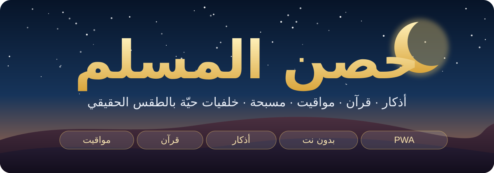
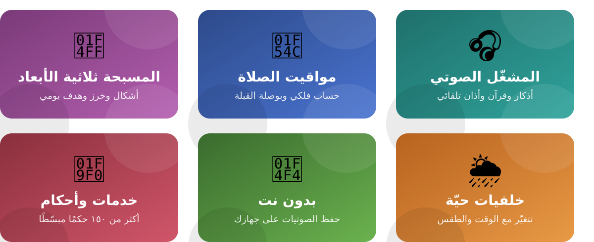
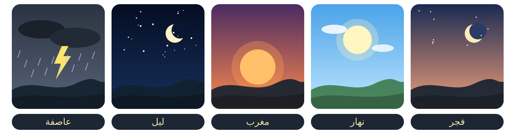
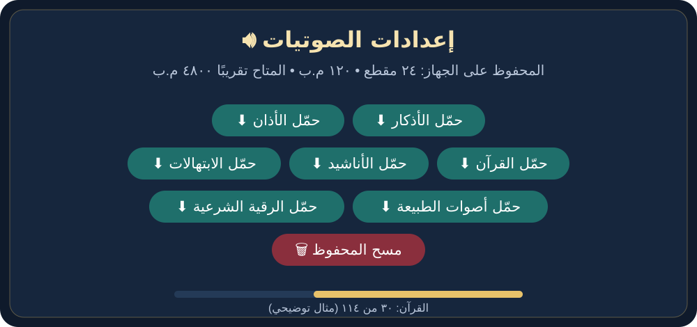

<div dir="rtl" align="right">

<p align="center"></p>

# 🕌 حصن المسلم

تطبيق إسلامي عربي يعمل من المتصفح كتطبيق ويب تقدّمي (PWA)، يجمع الأذكار والقرآن والمواقيت والمتابعات اليومية في واجهة واحدة بخلفيات متحركة تتغيّر مع وقت الصلاة والطقس الفعلي.

التطبيق ملف `index.html` واحد، ومعه ملفان للتثبيت والعمل بدون اتصال.

<p align="center"></p>

---

<a id="المحتويات"></a>

## 📚 المحتويات

1. [✨ المميزات](#المميزات)
2. [🚀 الملفات والتشغيل](#الملفات-والتشغيل)
3. [📖 طريقة الاستخدام](#طريقة-الاستخدام)
4. [🎵 إضافة ملفاتك الصوتية](#إضافة-ملفاتك-الصوتية)
5. [🌙 أصوات وضع السكون](#أصوات-وضع-السكون)
6. [📴 الصوتيات بدون نت](#الصوتيات-بدون-نت)
7. [🌦️ تجربة الطقس والتخصيص](#تجربة-الطقس-والتخصيص)
8. [🔄 التحديث](#التحديث)
9. [🔒 الخصوصية والبيانات](#الخصوصية-والبيانات)
10. [⚠️ ملاحظات وحدود](#ملاحظات-وحدود)
11. [📝 سجل التغييرات](#سجل-التغييرات)

---

<!-- لإضافة لقطات شاشة حقيقية: ضعها في assets/screenshots/ وأضف سطرًا مثل:
 -->

<a id="المميزات"></a>

## ✨ المميزات

### 🎧 المشغّل الصوتي
- تشغيل وإيقاف، السابق والتالي، وتقديم ورجوع ١٠ ثوانٍ، مع حلقة تقدّم والوقت.
- ثلاثة أقسام: **الآن** (يختار الأنسب للوقت)، و**قرآن**، و**أذكار** (أذكار وابتهالات وأناشيد).
- **الآن** يختار تلقائيًا: أذكار الصباح من الفجر إلى الظهر، وأذكار المساء من العصر إلى العشاء، وسورة الكهف من مغرب الخميس إلى مغرب الجمعة، أو ورد هادئ.
- 📣 **الأذان** يُشغَّل تلقائيًا عند دخول كل صلاة ما دام التطبيق مفتوحًا، ويمكن وضع أذان خاص للفجر.
- سرعة التشغيل: ٠٫٨٥× و١× و١٫٢٥× و١٫٥×.
- 😴 **مؤقت النوم**: ١٥ دقيقة أو ٣٠ أو ساعة أو ساعة ونصف، ويخفض الصوت تدريجيًا قبل الإيقاف.
- التحكم من شاشة القفل وإشعارات الوسائط.
- **التشغيل بدون نت**: أي مقطع يشتغل مرة يُحفظ على جهازك تلقائيًا، ويمكن تحميل القرآن والأذكار والأذان والأناشيد والابتهالات وأصوات الطبيعة والرقية الشرعية مقدمًا من «الإعدادات ← صوتيات» (التفاصيل في [الصوتيات بدون نت](#الصوتيات-بدون-نت)).
- إن لم تضف ملفاتك، يستخدم التطبيق ملفات افتراضية من الإنترنت (سور القرآن بصوت ماهر المعيقلي، وأذكار الصباح والمساء، وتسبيحات، وأذان).

### 🏠 الشاشة الرئيسية
- 📅 **التاريخ الهجري**: يفتح بطاقة فيها اليوم والتاريخ الميلادي والقبطي والهجري الشمسي وطور القمر والمناسبات القريبة.
- ⏳ **عدّاد الصلاة القادمة**: يفتح مواقيت اليوم كاملة واتجاه القبلة.
- 🌄 **خلفيات حية** تتغيّر مع وقت الصلاة والطقس الحقيقي: شمس وقمر ونجوم وسحب ومطر وثلج وبرق وضباب ورياح.

### 🙈 وضع إخفاء الأزرار
يُخفي كل الواجهة ويُبقي الخلفية واسم المقطع، والصوت يواصل التشغيل. اضغط في أي مكان للرجوع.

### 🌙 وضع السكون
- الخلفية فقط، بلا أي أزرار أو أسماء، ويوقف المشغّل.
- يشغّل صوتًا من الطبيعة يناسب الوقت والطقس، ويتكرر تلقائيًا ما دامت الصفحة مفتوحة، ويتبدّل وحده لو تغيّر الجو أو دخل وقت جديد.
- لو شُغّل الأذان أثناءه تسكت الطبيعة مؤقتًا ثم تعود.
- اضغط في أي مكان للخروج.

| الجو | الصوت |
|---|---|
| 🌅 فجر أو نهار، والجو صافٍ أو غائم | 🐦 عصافير |
| 🌇 مغرب | 🦗 صراصير الحقل |
| 🌃 ليل | 🐸 ضفادع مع صراصير |
| 💨 رياح (٣٠ كم/س فأكثر) | 🌬️ رياح |
| 🌦️ مطر خفيف | 🌦️ مطر خفيف |
| 🌧️ مطر | 🌧️ مطر |
| ⛈️ مطر غزير | 🌧️ مطر غزير |
| 🌩️ عاصفة رعدية | ⚡ عاصفة |
| ❄️ ثلج | ❄️ ثلج |
| 🌬️ رياح مع مطر أو عاصفة أو ثلج | 🎚️ الصوت الأساسي مع رياح خفيفة |

### 🎨 الخلفيات

<p align="center"></p>
عشرة أشكال تُختار من «إعدادات المظهر»: تلقائية، أنمي، دمى محشوة، جبال، بحر، غابة، شفق، غروب، شروق، هادئة. وفيها أيضًا اللون المميز، وأربعة أحجام للخط، و**الوضع الخفيف** الذي يوقف تأثيرات السماء لتوفير البطارية.

### 🕌 مواقيت الصلاة
- حساب فلكي حسب موقعك، بالتحديد التلقائي أو باختيار المدينة.
- طرق الحساب: الهيئة المصرية، رابطة العالم الإسلامي، أم القرى، أمريكا الشمالية، جامعة كراتشي.
- اختيار المذهب في العصر، وتعديل كل صلاة بالدقائق.
- مواقيت الغد، وإمساكية رمضان، واتجاه القبلة بالبوصلة.

### 📿 المسبحة
- عدّاد تسبيح ثلاثي الأبعاد: اضغط الزر أو لمس الخرز، مع وضع **ملء الشاشة**.
- أربعة أشكال: حلقة مجسّمة، قطرة، بيضاوية، طويلة. وزر التسبيح يتكيّف تلقائيًا مع شكل المسبحة وحجم الخرز.
- ثمانية أنواع من الخرز، وعدد الخرز (تلقائي أو ١١ أو ٣٣ أو ٩٩ أو ١٠٠)، والخيط والإمام والشرابة والفواصل وتدرّج الألوان والإكسسوارات.
- هدف يومي، وتراجع وتصفير، وإضافة أذكار خاصة بك.
- صوت النقر والاهتزاز، وتنبيه صوتي للانتقال إلى الذكر التالي.
- «الصلاة على النبي ﷺ» و«عداد التوبة والاستغفار» عدّادان مستقلان.

### 🧰 الخدمات
قائمة تُفتح بزر **خدمات**، وفيها ستة أقسام. وفيها أكثر من ١٥٠ حكمًا شرعيًا مبسّطًا موزّعة على الأقسام.

| القسم | محتواه |
|---|---|
| 📿 **الذكر** | المسبحة · أذكار الصباح والمساء وبعد الصلاة والنوم والاستيقاظ · أذكار المناسبات والاستخارة ودخول المنزل · مفضلة الأذكار · الرقية الشرعية (آيات وأدعية واستماع وآداب) · ذكر اليوم وأدعية مأثورة وحديث اليوم وأسماء الله الحسنى والأربعون النووية |
| 🕌 **الصلاة** | متتبع الصلوات اليوم · قضاء الفوائت · الاستعداد للصلاة · مواقيت الغد · الضحى والليل · اتجاه القبلة · نوافل اليوم · السنن الرواتب · سنن الجمعة · خطة قيام الليل · أحكام الصلاة والطهارة والحيض والنفاس · خطوات الوضوء وركعات الصلوات وصلاة المسافر |
| 🌙 **الصيام** | صيام اليوم · رمضان · قضاء الصيام · الإمساكية · ساعات الصيام · الصيام المستحب القادم · ست شوال · صيام التطوع · أحكام الصيام |
| 💰 **الزكاة** | حاسبة زكاة المال · زكاة الفطر · الكفارات والفدية · سجل الصدقات · خطة الصدقة الشهرية · الصدقة الجارية · أحكام الزكاة |
| 📖 **القرآن** | ورد اليوم والأسبوع · سجل الختمات · مؤقت التدبر والورد · خطة الختمة · حاسبة الورد · متابعة الحفظ وجدول المراجعة وحاسبة الحفظ وخريطة الحفظ · التجويد · فهرس السور · الأنبياء في القرآن · دفتر تدبر الآيات |
| ➕ **المزيد** | عادات الخير وأعمال خير مقترحة وتحدي ٣٠ يومًا ومسار التوبة · دفاتر الفوائد والامتنان ومحاسبة النفس والدعوات · أحكام العقيدة والحج والنذر واليمين والجنائز والمعاملات والأسرة والميراث واللباس والطعام والترفيه والأخلاق · حاسبة المواريث · اختبر معلوماتك · أركان الإسلام والإيمان · إنجازاتي والتقرير الأسبوعي · التقويم الهجري والمناسبات ومحوّل التاريخ · مواعيدي · الإعدادات |

### 🔔 التنبيهات والتذكير
تُفعَّل من «إعدادات التنبيهات»، وتشمل:
- 🕌 **الصلاة**: إشعار الأذان، وتذكير قبل الصلاة بـ ٥ أو ١٠ أو ١٥ أو ٣٠ دقيقة.
- 📿 **الأذكار**: الصباح والمساء.
- 📆 **الجمعة والصيام والزكاة**: سورة الكهف، وصيام الاثنين والخميس، والأيام البيض، وحول الزكاة.
- 📊 **المتابعة**: التقرير الأسبوعي، وتقرير اليوم، وتذكير النسخ الاحتياطي.

### 💾 النسخ الاحتياطي
«نسخ احتياطي» يحفظ كل بياناتك في ملف نصي على جهازك، و«استعادة» ترجعها من هذا الملف.

### 🧭 الجولة التعريفية
عند أول فتح تظهر جولة من ١٧ خطوة تضيء كل زر وخدمة وتشرحها. تُعاد من **الإعدادات ← المظهر ← إعادة الجولة التعريفية**.

---

<a id="الملفات-والتشغيل"></a>

## 🚀 الملفات والتشغيل

### 📁 الملفات الأساسية

| الملف | وظيفته |
|---|---|
| 📄 `index.html` | التطبيق كله |
| 🧩 `manifest.json` | بيانات التثبيت: الاسم والأيقونات واللون واتجاه RTL |
| ⚙️ `sw.js` | العمل بدون اتصال (كاش الصفحة) وحفظ المقاطع الصوتية للتشغيل بدون نت، وفتح التطبيق من الإشعار |

ضع الملفات الثلاثة في **نفس المجلد**.

### ▶️ التشغيل
1. ارفع المجلد على استضافة تدعم **HTTPS** (مثل GitHub Pages أو Netlify أو Cloudflare Pages)، أو جرّبه محليًا على `localhost`.
2. افتح `index.html` من المتصفح (أو الرابط الرئيسي).
3. اضغط **ابدأ** ثم تابع الإعداد الأول: تحديد الموقع، ثم طريقة الحساب، ثم الجولة التعريفية.

> 💡 **ملاحظة:** لا يعمل التثبيت وملف `sw.js` عند فتح الملف مباشرة بـ `file://`. التطبيق نفسه يعمل، لكن بدون تثبيت.

### 📲 التثبيت على الشاشة الرئيسية
- **أندرويد / كروم**: من قائمة المتصفح اختر «تثبيت التطبيق» أو «إضافة إلى الشاشة الرئيسية».
- **آيفون / سفاري**: زر المشاركة ثم «إضافة إلى الشاشة الرئيسية».

بعد التثبيت يفتح بكامل الشاشة.

### 🗂️ هيكل المجلد المقترح

```
├── index.html
├── manifest.json
├── sw.js
└── audio/
    ├── adhan/        adhan.mp3  adhan_fajr.mp3
    ├── quran/        018.mp3 ...
    ├── adhkar/       ...
    ├── ibtihalat/    ...
    ├── anasheed/     ...
    ├── ruqyah/       ruqyah.mp3
    └── ambient/      birds.mp3  crickets.mp3  frogs.mp3  wind.mp3
                      lightrain.mp3  rain.mp3  heavyrain.mp3  storm.mp3
```

---

<a id="طريقة-الاستخدام"></a>

## 📖 طريقة الاستخدام

### 🏠 الشاشة الرئيسية
- **زر التشغيل** (الدائرة الذهبية): تشغيل وإيقاف. وحوله السابق والتالي وتقديم ورجوع ١٠ ثوانٍ.
- **الآن / قرآن / أذكار** في الأسفل: اختيار نوع المقطع. وفي «أذكار» يظهر شريط للتبديل بين الأذكار والابتهالات والأناشيد.
- **خدمات**: تفتح قائمة الأقسام الستة. اضغط على أي قسم لتظهر موضوعاته، وزر الرجوع يعيدك إلى كل الأقسام.
- **الأزرار العلوية** من اليمين لليسار: التاريخ الهجري، ثم وضع إخفاء الأزرار، ثم وضع السكون، ثم الصلاة القادمة.

### 🙈 وضع إخفاء الأزرار
اضغط الزر ذي أقواس التركيز، فتختفي الواجهة وتبقى الخلفية واسم المقطع. اضغط في أي مكان للرجوع.

### 🌙 وضع السكون
1. اضغط زر الهلال في الشريط العلوي.
2. يختفي كل شيء ويتوقف المشغّل، ويبدأ الصوت المناسب لوقتك وطقسك.
3. يظهر اسم الصوت لثوانٍ ثم يختفي.
4. اضغط في أي مكان (أو Escape) للخروج.

### 📿 المسبحة
1. من **خدمات ← الذكر ← المسبحة**.
2. اضغط الزر في المنتصف، أو المس خرزة، للتسبيح.
3. اختر الذكر من القائمة أو أضف ذكرًا خاصًا بك، وحدّد هدفًا للعدد.
4. **تراجع** يلغي آخر تسبيحة، و**تصفير** يبدأ من جديد، و**ملء الشاشة** يكبّر المسبحة.
5. من **المزيد ← الإعدادات ← المسبحة**: الشكل والخرز والألوان والصوت والاهتزاز.

### ⚙️ الإعدادات
من **خدمات ← المزيد ← الإعدادات**:

| الإعداد | ما فيه |
|---|---|
| التنبيهات | الأذان والتذكيرات |
| المواقيت | طريقة الحساب والمذهب والمدينة والتعديل بالدقائق |
| التشغيل | سرعة الصوت ومؤقت النوم |
| صوتيات | حجم المحفوظ على الجهاز وتحميل القرآن والأذكار والأذان والأناشيد والابتهالات وأصوات الطبيعة والرقية الشرعية للتشغيل بدون نت، ومسح المحفوظ |
| المظهر | الخلفية واللون وحجم الخط والوضع الخفيف وتخفيف التأثيرات وإعادة الجولة |
| المسبحة | شكل المسبحة والخرز والألوان والصوت والاهتزاز |
| نسخة احتياطية | حفظ البيانات واستعادتها |

### 👆 السحب الجانبي
- **في الشاشة الرئيسية**: اسحب يمينًا أو يسارًا فوق منطقة العنوان أو أزرار التحكم للانتقال إلى المقطع السابق أو التالي.
- **في قائمة الخدمات**: اسحب يمينًا أو يسارًا على مساحة فارغة من الموضوع المفتوح للانتقال إلى القسم السابق أو التالي.
- **لا يعمل السحب** إذا بدأت الحركة من أحد هذه العناصر، وتعمل بالضغط فقط:
  - القوائم الفرعية (أذكار / ابتهالات / أناشيد) وشريط الأقسام السفلي (الآن / قرآن / أذكار / خدمات).
  - أي زر أو شريحة اختيار أو شريط أقسام الخدمات.
  - حقول الإدخال والقوائم المنسدلة والعجلات والمنزلقات.
- أثناء البحث داخل الخدمات يتوقف السحب الجانبي بين الأقسام.

### ⌨️ اختصارات لوحة المفاتيح
- **Space**: تشغيل وإيقاف.
- **السهم الأيسر / الأيمن**: المقطع التالي / السابق.
- **Escape**: الخروج من وضع إخفاء الأزرار أو وضع السكون أو الجولة.
- داخل الجولة: السهم الأيسر للتالي، والسهم الأيمن للسابق، وEnter للتالي.

---

<a id="إضافة-ملفاتك-الصوتية"></a>

## 🎵 إضافة ملفاتك الصوتية

افتح `index.html` وابحث عن **منطقة التعديل** (الكلمة `MY_AUDIO`). كل ملف سطر واحد:

```js
const MY_AUDIO = [
  { title: 'مولاي إني ببابك', file: 'audio/ibtihalat/mawlaya.mp3', type: 'ibtihalat' },
  { title: 'طلع البدر علينا',  file: 'audio/anasheed/tala3.mp3',    type: 'anasheed' },
];
```

الأنواع (`type`):

| النوع | الاستخدام |
|---|---|
| `quran` | تلاوة أو سورة، تظهر في زر «قرآن» |
| `adhkar` | أذكار وأدعية عامة، تظهر في زر «أذكار» |
| `ibtihalat` | ابتهالات |
| `anasheed` | أناشيد |
| `morning` | أذكار الصباح، تُشغَّل تلقائيًا من الفجر إلى الظهر |
| `evening` | أذكار المساء، تُشغَّل تلقائيًا من العصر إلى العشاء |
| `kahf` | سورة الكهف، من مغرب الخميس إلى مغرب الجمعة |
| `adhan` | الأذان عند دخول كل صلاة |
| `adhan_fajr` | أذان الفجر (اختياري) |
| `ruqyah` | تسجيل الرقية الشرعية في «استماع» |

ملاحظات:
- أي نوع تضيف له ملفًا يحلّ محل الملفات الافتراضية من الإنترنت لهذا النوع.
- أي نوع لا تضيف له شيئًا يستخدم الملفات الافتراضية.
- يمكنك إضافة أكثر من ملف لنفس النوع، والأسماء العربية والمسافات مقبولة.

---

<a id="أصوات-وضع-السكون"></a>

## 🌙 أصوات وضع السكون

تُضاف في مصفوفة `MY_AMBIENT` تحت `MY_AUDIO` مباشرة بنفس الطريقة. الأسماء الافتراضية جاهزة، فيكفي وضع الملفات في `audio/ambient/` بنفس الأسماء:

```js
const AMBIENT_VOLUME = 0.8;   // مستوى الصوت العام من 0 إلى 1
const MY_AMBIENT = [
  { type: 'birds',     file: 'audio/ambient/birds.mp3' },
  { type: 'crickets',  file: 'audio/ambient/crickets.mp3' },
  { type: 'frogs',     file: 'audio/ambient/frogs.mp3' },
  { type: 'wind',      file: 'audio/ambient/wind.mp3' },
  { type: 'lightrain', file: 'audio/ambient/lightrain.mp3' },
  { type: 'rain',      file: 'audio/ambient/rain.mp3' },
  { type: 'heavyrain', file: 'audio/ambient/heavyrain.mp3' },
  { type: 'storm',     file: 'audio/ambient/storm.mp3' },
  // { type: 'thunder', file: 'audio/ambient/thunder.mp3' },
  // { type: 'snow',    file: 'audio/ambient/snow.mp3' },
];
```

| النوع | متى يُستخدم | البديل لو غير موجود |
|---|---|---|
| `birds` | الفجر والنهار | لا يوجد |
| `crickets` | المغرب، ومع الضفادع ليلًا | لا يوجد |
| `frogs` | الليل | لا يوجد |
| `wind` | رياح ٣٠ كم/س فأكثر، وبصوت خفيف مع المطر | لا يوجد |
| `lightrain` | مطر خفيف أو رذاذ | `rain` |
| `rain` | مطر متوسط | لا يوجد |
| `heavyrain` | مطر غزير | `rain` |
| `storm` | عاصفة رعدية | `heavyrain` مع `thunder` |
| `thunder` | رعد (اختياري) يُضاف فوق المطر الغزير | لا يوجد |
| `snow` | ثلج (اختياري) | `wind` |

نصائح:
- يُفضَّل ملف مدته **دقيقة أو أكثر**، فالتكرار بتلاشٍ متداخل بلا فجوة.
- أكثر من ملف لنفس النوع يتبدّل بينها عشوائيًا مع كل دورة.
- أي نوع بلا ملف يُتخطّى بهدوء. وإن لم يوجد ملف مناسب للجو يظهر «لا توجد ملفات صوتية لهذا الجو».
- على الآيفون التبديل بين الأصوات يكون مفاجئًا وبلا تلاشٍ، لأن المتصفح يتجاهل التحكم في مستوى الصوت.

---

<a id="الصوتيات-بدون-نت"></a>

## 📴 الصوتيات بدون نت

يحفظ التطبيق المقاطع الصوتية على جهازك فتشتغل بعدها بدون إنترنت، حتى بعد إغلاق المتصفح وفتحه من جديد. وهذه الميزة تعتمد على `sw.js`.

<p align="center"></p>

### 💡 الحفظ التلقائي
أي مقطع يشتغل مرة واحدة يُحفظ في الخلفية وحده. وفي قوائم القرآن والأذكار والابتهالات والأناشيد تظهر علامة **✓ بدون نت** جنب المقاطع المحفوظة.

### ⬇️ التحميل المسبق من الإعدادات
من **خدمات ← المزيد ← الإعدادات ← صوتيات**:

| الزر | ما يحمّله |
|---|---|
| ⬇ 📿 حمّل الأذكار | أذكار الصباح والمساء والأذكار العامة |
| ⬇ 📣 حمّل الأذان | الأذان وأذان الفجر |
| ⬇ 📖 حمّل القرآن | كل سور القرآن (من `MY_AUDIO` بنوع `quran`، أو من المصدر الافتراضي لو لم تضف ملفاتك) |
| ⬇ 🎶 حمّل الأناشيد | كل مقاطع نوع `anasheed` |
| ⬇ 🤲 حمّل الابتهالات | كل مقاطع نوع `ibtihalat` |
| ⬇ 🐦 حمّل أصوات الطبيعة | كل ملفات `MY_AMBIENT`: عصافير ورياح وصراصير وضفادع ومطر ورعد وثلج |
| ⬇ 🛡️ حمّل الرقية الشرعية | ملفات نوع `ruqyah` في `MY_AUDIO` (إن لم توجد ملفات يظهر تنبيه) |
| 🗑 مسح المحفوظ | يمسح كل المقاطع المحفوظة، فتحتاج نت لتشغيلها من جديد |

- أعلى القسم سطر يعرض عدد المقاطع المحفوظة وحجمها والمساحة المتاحة تقريبًا، ويظهر عداد التقدم أثناء التحميل.
- المقاطع المحفوظة بالفعل تُتخطّى، فيمكن إعادة الضغط على أي زر لاستكمال ما تعذّر.
- ⚠️ **القرآن كامل حجمه كبير** (غالبًا مئات الميجابايت أو أكثر)، لذلك يطلب الزر تأكيدًا قبل البدء. يُفضَّل واي فاي ومساحة كافية على الجهاز.
- يمكن أيضًا تحميل مقاطع محددة من زر **⬇ تحميل بدون نت** في نافذة اختيار القرآن والأذكار.

### 📡 شريط «غير متصل»
عند انقطاع الاتصال يظهر شريط صغير بعبارة «لا يوجد اتصال» وأن المقاطع المحفوظة تعمل بدون نت، ثم يظهر «رجع الاتصال» عند عودته.

### 🗄️ كاش الصوت
- يُحفظ الصوت في كاش مستقل اسمه `hisn-audio` داخل `sw.js`، ولا يُمسح عند تحديث التطبيق (تغيير اسم كاش الصفحة `C` لا يمسحه).
- يدعم التشغيل المحفوظ **التقديم والترجيع** داخل المقطع (طلبات Range).

### 🚧 شروط وحدود
- 🔐 يحتاج فتح التطبيق عبر **HTTPS** (أو `localhost`)، وإلا تظهر رسالة أن الحفظ غير متاح.
- الملفات الصوتية من مواقع خارجية تُحفظ فقط لو سمح موقعها بذلك (CORS). إن لم يسمح، تظهر رسالة «اتحفظ كذا وتعذّر كذا»، وتبقى المقاطع المحفوظة شغالة.
- قد يرفض المتصفح الحفظ لو امتلأت مساحة الجهاز، وقد يمسح بعض المتصفحات بيانات المواقع التي لا تُستخدم فترة طويلة.

---

<a id="تجربة-الطقس-والتخصيص"></a>

## 🌦️ تجربة الطقس والتخصيص

لتجربة أي حالة جو دون انتظار الطقس الحقيقي:

- أضف للرابط `?wx=` مع أحد القيم: `clear` · `partly` · `cloudy` · `fog` · `drizzle` · `rain` · `heavy` · `storm` · `snow` · `windy`

  مثال: `index.html?wx=storm`
- أو من وحدة تحكم المتصفح (Console): `wxSim('storm')`، ولإلغاء المحاكاة `wxSim()`.

لتغيير نصوص الجولة التعريفية: هي في مصفوفة `S` أول سكريبت الجولة داخل `index.html`.

---

<a id="التحديث"></a>

## 🔄 التحديث

بعد أي تعديل على `index.html` ارفع الملفات المعدّلة، وغيّر رقم الكاش في أول `sw.js` ليأخذ المستخدمون النسخة الجديدة:

```js
const C='index';   // اسم الكاش في أول sw.js
```

التطبيق يحمّل النسخة الأحدث من الشبكة أولًا ويحدّث الكاش، وعند انقطاع الاتصال يفتح من الكاش. فعادةً يكفي رفع `index.html` الجديد وفتح التطبيق مرتين. وإن أردت إجبار كل الأجهزة على مسح الكاش القديم، غيّر اسم الكاش `C` (مثل `'index-2'`) عند التحديث.

كاش الصوت `hisn-audio` منفصل ولا يتأثر بتغيير `C`، فلا يضطر المستخدم لإعادة تحميل المقاطع بعد كل تحديث. غيّر اسمه فقط لو أردت مسح كل المقاطع المحفوظة من كل الأجهزة.

---

<a id="الخصوصية-والبيانات"></a>

## 🔒 الخصوصية والبيانات

- **كل بياناتك** (التسبيح والمتابعات والدفاتر والإعدادات) تُحفظ على جهازك فقط في المتصفح، ولا يوجد خادم أو حساب.
- لا تنسَ **النسخ الاحتياطي** قبل مسح بيانات المتصفح أو تغيير الجهاز.
- الاتصالات الخارجية الوحيدة:
  - **الطقس**: من خدمة Open-Meteo باستخدام إحداثيات موقعك.
  - **الملفات الصوتية الافتراضية**: من الإنترنت لو لم تضف ملفاتك.
  - **تحميل الصوتيات**: من أماكن ملفاتك (أو المصادر الافتراضية)، وتُحفظ على جهازك فقط في كاش المتصفح.
- الموقع يُطلب مرة لحساب المواقيت والقبلة، ويمكن بدله اختيار المدينة يدويًا.

---

<a id="ملاحظات-وحدود"></a>

## ⚠️ ملاحظات وحدود

- **التنبيهات** تعمل ما دام التطبيق مفتوحًا (ولو في الخلفية)، ولا يستطيع ملف HTML وحده إرسال إشعار والتطبيق مغلق.
- الأذان التلقائي كذلك يعمل والتطبيق مفتوح.
- مواقيت الصلاة حساب فلكي تقريبي، فيُنصح بمطابقتها مع الجهة المعتمدة في بلدك وتعديلها بالدقائق عند الحاجة.
- الأحكام الشرعية في الخدمات مبسّطة للتعلّم، وللفتوى الخاصة يُرجع لأهل العلم.
- يعمل التطبيق على المتصفحات الحديثة. وقد تختلف بعض التفاصيل، كالإشعارات والتحكم في مستوى الصوت، بين الأجهزة.

---

<a id="سجل-التغييرات"></a>

## 📝 سجل التغييرات

### ✨ أزرار تحميل الصوتيات في «الإعدادات ← صوتيات»
- **الجديد**: أزرار لتحميل **القرآن** و**الأناشيد** و**الابتهالات** و**أصوات الطبيعة** (عصافير ورياح وغيرها) و**الرقية الشرعية** للتشغيل بدون نت، بجانب أزرار الأذكار والأذان.
- **السلوك**: تتخطى المحفوظ، وتعرض عدّاد التقدم، وتطلب تأكيدًا قبل تحميل القرآن كامل لكبر حجمه. وزر الرقية يعرض تنبيهًا لو لم تُضف ملفات `ruqyah`.
- **الملف المتأثر**: `index.html` فقط، و`sw.js` بلا تغيير.

### 🔧 إصلاح اختفاء «التنبيهات» و«المواقيت» على أندرويد
- **المشكلة**: في شريط اختيار الإعدادات (التنبيهات، المواقيت، التشغيل، المظهر، المسبحة، نسخة احتياطية، نبذة عنا) كانت الأزرار الأولى تخرج خارج المستطيل على الشاشات الضيقة (مثل موبايلات أندرويد) ولا يمكن الوصول إليها بالسحب.
- **السبب**: كان الشريط مضبوطًا على التوسيط (`justify-content:center`) مع التمرير الأفقي، فتتوزع الزيادة على الجهتين، والجهة الواقعة عند بداية الشريط في العربية لا يمكن تمريرها.
- **الإصلاح**: يبدأ الشريط من أوله فيظهر «التنبيهات» أولًا، وتُستخدم هوامش تلقائية للتوسيط فلا تعمل إلا إذا اتسع الشريط للأزرار كلها. وينطبق ذلك على كل أشرطة اختيار المجموعات.
- **الملف المتأثر**: `index.html` فقط (قاعدة `.sc[data-g] > .seg`).

### 🔧 إصلاح السحب الجانبي في القوائم الفرعية
- **المشكلة**: عند التنقل بين القوائم الفرعية بالسحب أو اللمس المتحرك، كان التطبيق يعتبرها سحبة تنقّل، فينتقل إلى المقطع أو القسم السابق أو التالي بدل البقاء في القائمة.
- **الإصلاح**:
  - في الشاشة الرئيسية: لم يعد السحب يغيّر المقطع إذا بدأ من قائمة فرعية أو شريط الأقسام أو زر أو حقل إدخال.
  - في قائمة الخدمات: أُضيفت الأزرار وشرائح الاختيار والقوائم الفرعية وشريط الأقسام إلى العناصر التي لا يبدأ منها تغيير القسم بالسحب.
- **الملف المتأثر**: `index.html` فقط.

</div>
